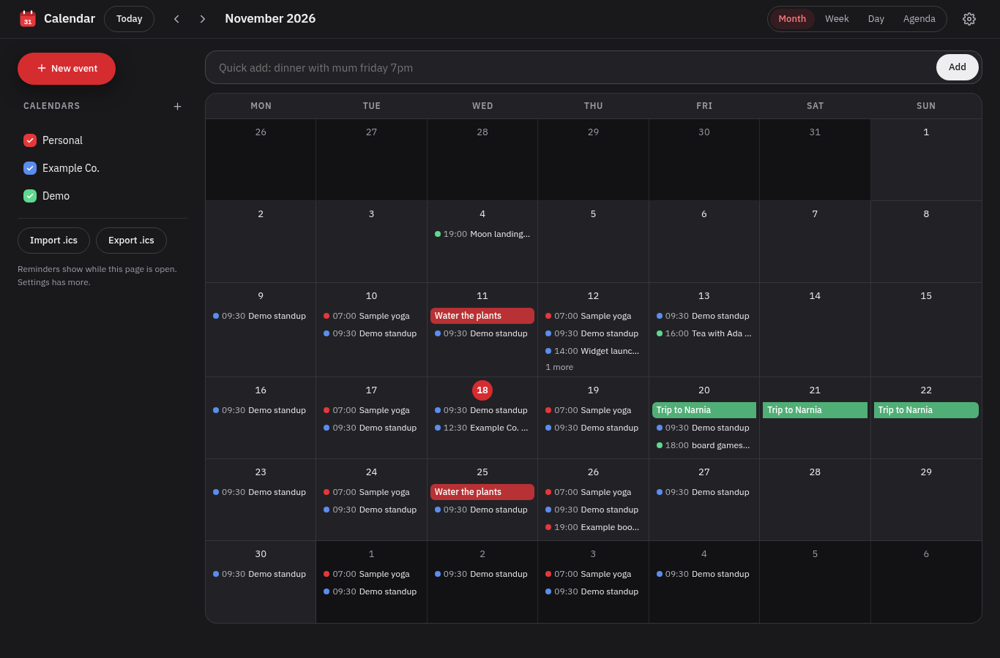

<div align="center">

# Starfire Calendar

**Your own free take on Google Calendar. Month, week, day and agenda views, several calendars, repeating events, reminders, .ics import and export, a quick add line that understands "dinner with mum friday 7pm", and CalDAV sync so the phone's own calendar app shows the same events.**

[](https://www.python.org/)
[](https://flask.palletsprojects.com/)
[](https://radicale.org/)
[](LICENSE)

</div>



---

## Overview

Starfire Calendar is a small self-hosted calendar. It has its own sign-in for one
owner account, so a copy runs on its own. Like Tasks, Keep Notes and Read
Later it can also sit behind a sign-in proxy: the author runs it behind the
starfire sign-in, where Caddy checks the sign-in, then passes the request
to Starfire Calendar on `127.0.0.1`.

It runs on one machine on its own (see "Run it locally"). The files for
running it on a server behind Caddy are in `deploy/` and `deploy.sh`.

- **Views**: month, week, day and agenda (the next 60 days). The week and
  day views put overlapping events side by side and draw a line at the
  current time. On a phone the page is one column, starts in the agenda and
  has a round button for a new event.
- **Events**: all-day, timed or spanning several days, with a location,
  notes and up to 5 reminders. Each event lasts at most 366 days; for longer,
  make it repeat.
- **Several calendars**, each with a name and a colour. Tick a calendar off
  in the side bar to hide it. The first one, `Personal`, is made on first
  start; the last calendar cannot be deleted.
- **Repeats**: daily, weekly on chosen days, monthly (on the same date, or
  on the same weekday such as "the second Tuesday" or "the last Friday"),
  yearly, every N of those, ending never, on a date or after a number of
  times. A repeat made on a phone that this page cannot show (for example
  "every 2nd and 15th") is kept as it is and shown as "Custom rule from
  another device". Import refuses rules that repeat more than once a day.
  One made on a phone that repeats hourly is expanded at most 1000 times
  per view; one that repeats every minute or second is shown once, on its
  first date, as a custom rule, and can only be changed as a whole.
- **Edit one date or all**: changing or deleting a repeating event asks
  whether it is for this date only or for every date (see "Repeating
  events").
- **Reminders**: stored in the event itself, so a synced phone rings them on
  its own; the page shows them too, and Arty can send them (see
  "Reminders").
- **Quick add**: type the whole event on one line. The line shows what it
  understood before you press Enter.
- **.ics import and export**, one calendar or all of them.
- **CalDAV sync** for phones, with app passwords made in Settings. It is
  **switched off by default** (see "Phone sync").
- **Keyboard keys**: `t` today, `j` / `k` (or the arrow keys) later and
  earlier, `m` `w` `d` `a` the four views, `n` new event, `/` quick add,
  `?` settings.

---

## Time zones and the clock changes

Everything is worked out in `Europe/London` (set `TIME_ZONE` to change it).

- Timed events are stored with `TZID=Europe/London`, so "every Monday at
  09:00" stays at 09:00 in both summer and winter time, and phones show it at
  the right moment.
- A time that does not exist because the clocks go forward (for example
  01:30 on 29 March 2026) is refused with a message instead of being moved
  silently.
- A time that happens twice because the clocks go back (01:30 on
  25 October 2026) means the first one, in summer time.
- All-day events are dates, not times, so they never move.

---

## Quick add

Words that are not understood stay in the title. A line without a date or
time, or without any title left, is refused with a message.

| You type | It means |
|---|---|
| `dinner with mum friday 7pm` | Friday at 19:00 to 20:00 (on a Friday, `friday` is today) |
| `dinner with mum next friday 7pm` | Friday of next week |
| `dentist tomorrow 9:30am` | tomorrow 09:30 to 10:30 (`tmrw` and `tmr` work too) |
| `breakfast 8am` | 08:00 today, or tomorrow if 08:00 has already passed |
| `call 19:00` | the same, with a 24-hour time |
| `meeting 3-4pm monday`, `meeting monday from 10am to 11:30am` | a start and an end (`to`, `until`, `till` or `-`) |
| `gig on 4 dec at 11pm until 1am` | ends the next morning |
| `lunch with sam at the pub tomorrow 1pm for 2 hours` | location `the pub`, 13:00 to 15:00 (`for 90 min`, `for 2h` too) |
| `dinner tonight`, `drinks tonight 7-11` | 19:00 tonight; a bare hour after `tonight` is in the evening |
| `holiday 24 dec to 27 dec` | an all-day event over several days |
| `conference 2027-03-01 all day #work` | all day, in the calendar called `work` (any case) |
| `payday 28/11`, `1st of december`, `dec 1` | that date; without a year, the next time it comes round |
| `mum's birthday 2 dec every year` | all day, repeating yearly (`daily`, `weekly`, `monthly`, `yearly`, `every day` and so on) |
| `gym every monday 7am`, `standup weekdays 9:15` | weekly on those days |
| `bins every 2 weeks` | every other week, from today |
| `"Friday 7pm drinks" next friday 6pm` | words in double quotes always stay in the title |

A date without a time makes an all-day event; a time without an end lasts an
hour. `in 3 days` and `in 2 weeks` count from today. `sun`, `sat`, `wed`,
`mar`, `may`, `jan` and the bare repeat words (`daily`, `weekly`,
`weekdays`, `monday` and so on) are ordinary words too, so they only count at
the end of the line or when the next word is understood as well (`sun cream
shopping tomorrow` keeps "sun cream" in the title); with `on` in front they
always count. `#name` picks a calendar by name, in any case; a name no
calendar has is refused. Without `#name` the event goes to the first
calendar in the side bar.

---

## Repeating events

- **This date only** (edit): the change is saved as an exception for that
  one date (`RECURRENCE-ID`), which phones understand. Deleting one date
  adds it to the series' skipped dates (`EXDATE`).
- **Every date** (edit): the whole series changes. Moving the time or day
  moves the dates already changed or skipped by the same amount, so they
  stay attached to the right dates (also when a weekly event moves to
  another weekday). Turning the repeat off keeps the event on the date it
  was opened from. Changing the repeat rule itself, or
  switching between all-day and timed, clears those single-date changes,
  because they no longer match any date.
- **Every date** (delete): the whole series goes.
- If a phone changed an event in the meantime, saving or deleting answers
  "changed somewhere else" (`409`) instead of overwriting it; reload and try
  again. The page sends the version it showed (`If-Match`), so a page left
  open for hours cannot undo a newer change.

---

## Reminders

Each reminder is a `VALARM` in the event ("15 minutes before", "1 day
before" and so on). A phone that syncs the calendar rings them itself.

The app also checks every 30 seconds for reminders that are due (looking up
to 29 days ahead, and up to 10 minutes late after a restart), sends each one
once, and:

- **always** shows it in any open Starfire Calendar page, as a banner and, once you
  allow it in Settings, as a browser notification. The page has to be open
  in some tab for this.
- **when linked to Arty**, also sends it to Arty's brain (`POST /v1/notify`,
  category `calendar`), so it reaches every device Arty notifies. When Arty
  cannot be reached or answers busy (`408`, `425`, `429`, `5xx`), the
  reminder is tried again on the next checks, at most 3 times within 10
  minutes. Redirects from Arty are not followed.

**Which one is in use now: browser notifications only.** `ARTY_URL` is empty
by default, and the link stays off unless you set it. `ARTY_URL` must be
`https://`, or `http://` to this machine only (`127.0.0.1`, `::1` or
`localhost`), because the key travels with every reminder; any other
address stops the app at start-up. To link Arty: set `ARTY_URL` to the brain's address, restart,
open Settings, press "Link Arty", approve the code it shows on the starfire
Arty devices page (`ARTY_APPROVE_URL`), and the page finishes the link. The
key Arty gives back is kept in `DATA_DIR/calendar.db` and never shown. The
link uses Arty's own device-link flow (`/v1/device/start`, then
`/v1/device/token`). It was tested against a stand-in in the tests, not the
live brain.

> **Note:** an Arty device key is not limited to notifications: it is the
> same kind of key a phone gets. The safe way is a notify-only key, which
> Arty's device link does not offer yet (its device code has no key scopes
> as of 13 Nov 2026). Until it does, approve "Calendar reminders" only if a
> full key is acceptable, and remove it on the starfire devices page to take
> it back.

---

## Phone sync (CalDAV)

> **Auth change, switched off by default.** CalDAV is the one part of the
> app reachable without the web sign-in, so it has its own passwords.
> It stays off (`CALDAV_ENABLED=false`) until you switch it on. While it is
> off, every CalDAV address answers `404`.

How it fits together:

```
phone ──https──▶ Cloudflare ──▶ cloudflared ──▶ Caddy :80
                                                  │ /dav, /.well-known/caldav (only from cloudflared)
                                                  ▼
                        CalDAV gate 127.0.0.1:DAV_PORT ──▶ Radicale 127.0.0.1:STORE_PORT
browser ──▶ starfire sign-in ──▶ web app 127.0.0.1:PORT ──────────▲
```

- **Radicale** keeps the events as `.ics` files under `DATA_DIR/collections`
  and speaks CalDAV. It listens on `127.0.0.1:STORE_PORT` only, with its own
  web page and sharing switched off, and accepts exactly one user: the app,
  with a random 64-character password in `DATA_DIR/store_password`
  (mode 600). The web app and the gate use that password; nothing else
  knows it.
- **The CalDAV gate** is the only way in from outside. It checks the user
  name (`CALDAV_USER`) and an **app password**, then passes the request on
  to Radicale with the internal password. Its rules:
  - App passwords are made in Settings, one per device: 24 random letters
    and digits in six groups (about 119 bits), shown **once**, stored only
    as a SHA-256 hash, revocable at any time (the next request from that
    device is refused). At most 50 at once.
  - **Failed sign-ins are limited**: 5 wrong passwords from one address in
    15 minutes blocks that address (`429` with `Retry-After`) even for the
    right password. Once 100 wrong passwords have arrived in that window
    from anywhere, each failing address gets only 1.
  - The visitor's address is taken from `Cf-Connecting-Ip` only when the
    request comes from a proxy in `TRUSTED_PROXIES`.
  - **HTTPS only**: with `CALDAV_REQUIRE_CLOUDFLARE_HTTPS=true` (the
    default) a request without Cloudflare's `Cf-Visitor: {"scheme":"https"}`
    is refused with `403`. The Caddy block only lets `/dav` in from the
    cloudflared machine (`TUNNEL_PEER` in `deploy/site.env`), so other
    machines on the same network are turned away before the header is read; a program on the
    cloudflared machine itself (or anything able to send from its address)
    could still set it by hand.
  - **Path tricks are refused**: `..`, `//`, back slashes, NUL and their
    encoded forms (`%2e`, `%2f`, `%5c`, `%00`) answer `404`; any path outside
    `/dav/<CALDAV_USER>/` answers `403`; `MOVE` may only target the same
    user's calendars.
  - Only the CalDAV methods are passed on, bodies are capped at 10 MB, and
    the starfire `X-Forwarded-User` header means nothing here.
- **The web app** reads and writes the same Radicale calendars, so a change
  on the phone shows on the page at the next refresh (every 5 minutes, or
  when the tab comes back into view) and the other way round.

Setting up a phone, once it is switched on (Settings shows the same):

- **Android**: install DAVx5, add an account with "Login with URL and user
  name": `https://calendar.example.com/dav/`, the user name from Settings
  and a new app password.
- **iPhone**: Settings, Calendar, Accounts, Add Account, Other, Add CalDAV
  Account. Server `calendar.example.com`, then the user name and the app
  password.

What was tested on the laptop with CalDAV switched on (scratch ports, not
the real data): a real CalDAV client (the Python `caldav` library) found the
server through `/.well-known/caldav`, listed the calendars, made a weekly
event that the web app showed at the right London time, saw an event made
on the web, expanded repeats with `REPORT`, saw a web "this date only" edit
as an exception, made a new calendar, used sync tokens and deleted; a wrong
password, a wrong user and a revoked password were all refused. With curl:
every path trick answered `404`, another user's path `403`, the sixth wrong
password `429` (and the right one from that address too), and Radicale's
own port refused requests without the internal password. **Not tested yet:
a real phone.**

---

## Requirements

- Python 3.11+
- The time zone data for `TIME_ZONE` (on Debian the `tzdata` package, there
  by default). The app refuses to start with a clear message if it is
  missing.

---

## Run it locally

```bash
git clone https://github.com/drew-codes-things/Calendar.git
cd Calendar
python3 -m venv .venv
.venv/bin/pip install -r requirements.txt
cp .env.example .env
./run-local.sh
```

Then open `http://127.0.0.1:8110`. `run-local.sh` starts Radicale in the
background and the app in front, and stops Radicale when the app stops.
The first visit asks you to make the owner account (see below). Data goes
to `./data`, which git ignores.

`AUTH_MODE=local` switches the sign-in off for a copy only you use on this
machine: it then refuses to listen on anything but `127.0.0.1`, `::1` or
`localhost`, and answers `421` to any other `Host` (so a web page cannot
reach it by DNS rebinding).

To keep it running in the background as a transient user unit, with the
data in `~/.local/share/calendar` and the settings in
`$HOME/.config/calendar/laptop.env` (the `.env.example` keys with that
`DATA_DIR`), run this from the Calendar folder:

```bash
systemd-run --user --collect --unit calendar-laptop -p MemoryMax=1G -p MemorySwapMax=0 \
  -p EnvironmentFile=$HOME/.config/calendar/laptop.env \
  -p WorkingDirectory="$PWD" \
  "$PWD/run-local.sh"
systemctl --user stop calendar-laptop
```

It does not start again after a reboot; run the first command again.

---

## First run and sign-in

Starfire Calendar has its own sign-in, switched on by default (`AUTH_MODE=builtin`).
There is one owner account and no sign-up page.

1. Start it (`./run-local.sh`) and open
   `http://127.0.0.1:8110`. With no account yet every page goes to
   **Set up**.
2. The app writes a one-time setup code to its log when it starts, a line
   like `no owner account yet: open /setup and enter the setup code ...`.
   Enter that code, a user name and a password (10 characters or more,
   twice). The code stops anyone else who reaches the page first from
   making the account, and it works once: if the owner file is ever
   deleted, the next visit to **Set up** writes a new code to the log.
3. After that, every page goes to **Sign in** until you sign in. A session
   lasts 30 days. `/signout` signs out on every device.

How it is protected:

- The password is stored as an scrypt hash in `DATA_DIR/owner.json`
  (mode 600), never in plain text.
- 5 wrong passwords or setup codes from one address within 15 minutes lock
  that address out for the rest of the 15 minutes (`429`). Attempts sent
  at once are counted before they are checked, IPv6 addresses count by
  their `/64` network, and after 100 failures from everywhere within 15
  minutes each address gets one try and each network three (IPv4 by `/24`,
  IPv6 by `/48`). A right password from a locked address is refused too.
- During such an attack one wrong password from a neighbour on the same
  provider network does not keep your new browser out: that takes three
  wrong passwords within 15 minutes from three of their addresses (IPv4)
  or three of their home lines (IPv6, where a line's whole `/56` counts as
  one address).
- A browser that has signed in before keeps a signed device cookie and has
  its own 5 tries, so a stranger who locks out your address (or the
  address of the proxy in front) cannot lock you out of that browser.
  During an attack from many networks that browser is the way in.
  Making a new owner account ends every device cookie of the old one.
- The session cookie is `HttpOnly`, `SameSite=Lax` and signed with the app's
  secret key. It is `Secure` everywhere except plain `http` on `localhost`,
  `127.0.0.1` or `[::1]` (`SECURE_COOKIES=auto`). On a plain `http` address
  on your home network the browser drops a `Secure` cookie and the sign-in
  page says so: use https, or set `SECURE_COOKIES=false` there.
- Forget the password? Stop the app, delete `DATA_DIR/owner.json`, start it
  again and set up a new owner with the new setup code from the log. Your
  data stays.

Behind a reverse proxy for https, with the own sign-in still on: list the
proxy's address in `TRUSTED_PROXIES` so the lockout counts each visitor's
address from `X-Forwarded-For` instead of the proxy's (the header is read
only from those addresses), and put the public host name in
`ALLOWED_HOSTS`. By default the own sign-in answers only on `localhost`,
`127.0.0.1`, `[::1]`, IP addresses and this machine's own name; any other
`Host` gets `421`, so a web page cannot reach a copy on your machine by
DNS rebinding.

To run it behind a sign-in proxy instead, set `AUTH_MODE=proxy` and list the
proxy's address in `TRUSTED_PROXIES`. The user header is then believed only
from those addresses; in the default mode it is never read.

---

## Configuration (`.env` or environment)

| Key | Description |
|---|---|
| `AUTH_MODE` | `builtin` (default): the app's own sign-in, one owner account. `proxy`: trust the user header from a sign-in proxy listed in `TRUSTED_PROXIES`. `local`: no sign-in, loopback only. |
| `BIND_HOST` | Where the web app and the gate listen. Default `127.0.0.1`. |
| `PORT` / `DAV_PORT` / `STORE_PORT` | Web app, CalDAV gate and Radicale. Defaults `8110`, `8111`, `8112`; they must differ. Radicale always listens on `127.0.0.1`. |
| `DATA_DIR` | Database (`calendar.db`: app passwords, sent reminders, the Arty key), the events (`collections/`), the internal store password, the owner account (`owner.json`) and the secret key. Default `./data`. |
| `TRUSTED_PROXIES` | Addresses or networks whose user header (and `Cf-Connecting-Ip`) are believed. No default: `AUTH_MODE=proxy` refuses to start without it. Networks with host bits set, or that reach public addresses, stop the app at start-up. In `builtin` mode, the proxies whose `X-Forwarded-For` gives the visitor's address to the lockout. |
| `ALLOWED_HOSTS` | In `builtin` mode, the only host names the app answers on, comma separated (others get 421). Empty: `localhost`, `127.0.0.1`, `[::1]`, IP addresses and this machine's own name. |
| `SECURE_COOKIES` | `auto` (default): the session cookie is `Secure` except on plain `http` to `localhost`, `127.0.0.1` or `[::1]`. `true` or `false` force it. Only used in `builtin` mode. |
| `USER_HEADER` | The header the proxy fills in. Default `X-Forwarded-User`. |
| `ALLOWED_USERS` | Optional comma separated list; any other user header value is refused. |
| `LOCAL_USER` | The user name in `local` mode. Default `local`. |
| `SECRET_KEY` | Optional. Without it a random key is made once in `DATA_DIR/secret_key` (mode 600). A key shorter than 32 bytes stops the app at start-up. |
| `TIME_ZONE` | Default `Europe/London`. |
| `CALDAV_ENABLED` | `false` (default) or `true`. |
| `CALDAV_USER` | The CalDAV user name. Default `owner`. |
| `CALDAV_REQUIRE_CLOUDFLARE_HTTPS` | `true` (default): refuse CalDAV requests that did not come over HTTPS through Cloudflare. Set `false` only for tests on `127.0.0.1`. |
| `PUBLIC_URL` | Shown in Settings as the CalDAV server address. Default `http://localhost:PORT`. |
| `ARTY_URL` | Arty's brain, for reminders. Empty (default): reminders only in the open page. Must be `https://`, or `http://` to `127.0.0.1`, `::1` or `localhost`. |
| `ARTY_APPROVE_URL` | The starfire page where the link code is approved, like `https://sign-in.example.com/arty-devices.html`. Empty by default; needed when `ARTY_URL` is set. |

---

## How sign-in and writes are protected

- In `builtin` mode (the default) a request is signed in only with the
  owner's session cookie; see [First run and sign-in](#first-run-and-sign-in).
  A user header is never read.
- In `proxy` mode a request is only signed in when it comes from an address
  in `TRUSTED_PROXIES` **and** carries a non-empty `USER_HEADER`. Every page
  and API call needs it except `/api/health`.
- The Caddy block in `deploy/` removes any `X-Forwarded-User` the visitor
  sends, checks the starfire session with `forward_auth` (the admin account
  only) and then sets `X-Forwarded-User` itself, to `SIGNED_IN_USER` from
  `deploy/site.env`. The CalDAV
  paths skip that check and go to the gate instead, only from cloudflared.
- Every write needs the `X-CSRF-Token` header from `/api/session` (an HMAC
  of the user made with the secret key), and a write whose `Origin` is a
  different host is refused.
- Pages ship a strict Content Security Policy (everything from the app
  itself), `X-Frame-Options: DENY`, `nosniff` and `no-referrer`; API answers
  are `no-store`. Event text is always put on the page as text, never as
  HTML.
- `DATA_DIR` is made (or tightened to) mode `700` and `calendar.db` mode
  `600` at every start, whatever the umask.
- Limits: page requests 2 MB plus 64 KB (CalDAV bodies 10 MB), imports
  2 MB and 500 events (checked before the file is read; 500 events took
  14.5 s on the laptop), titles and
  locations 500 characters, notes 10,000, a view at most 400 days and 5000
  events (the page says when it was cut short).

---

## Import and export

- **Export** (the button, or `GET /api/export.ics`, with `?calendar=<id>` for
  one calendar) gives a standard `.ics` file with every event, repeat,
  exception and reminder.
- **Import** adds the events in an `.ics` file to the calendar you pick. It
  never replaces anything: an event whose `UID` is already in that calendar
  is skipped and counted. Files from Google Calendar that only name their
  time zone in `X-WR-TIMEZONE` are converted first; a zone name this app
  does not know is refused with `400`. To-dos, journals and free/busy
  entries are skipped. Events that repeat more than once a day, or whose
  dates cannot be worked out (for example an end in the year 9999), are
  refused and listed with the reason. So are events whose dates take more
  than 0.1 s to work out (a daily repeat starting in the year 1 takes 1.4 s),
  and any events still unchecked after 20 s; import those again as a smaller
  file.

**Backup**: the events are plain `.ics` files in `DATA_DIR/collections`, and
the rest is in `DATA_DIR/calendar.db`. `deploy.sh backup` copies both (the
database with SQLite's online backup) on the server.

---

## Running it on a server

On that server Starfire Calendar trusts the gate instead of its own sign-in:
`deploy/calendar.env` sets `AUTH_MODE=proxy` and
`TRUSTED_PROXIES=127.0.0.1,::1`.

`deploy.sh` installs Starfire Calendar into a Proxmox container that already runs
Caddy and the starfire sign-in, reached with `ssh` and `pct`. `apply` checks
the Caddy block with `caddy validate` before every reload and puts the old
Caddyfile back if it fails.

The values for your own setup live in `deploy/site.env`, which git ignores.
Copy `deploy/site.env.example` and fill it in:

| Key | Description |
|---|---|
| `PROXMOX` | The ssh host name of the Proxmox machine. |
| `CT` | The number of the container that runs Caddy. |
| `SITE_HOST` | The host name Starfire Calendar is served on, like `calendar.example.com`. |
| `SIGNED_IN_USER` | The starfire admin account name; Caddy passes it on and it becomes `ALLOWED_USERS`. |
| `TUNNEL_PEER` | The address cloudflared reaches Caddy from; `/dav` is only let in from there. |
| `CALDAV_USER` | The CalDAV user name written into the container's env file on a first install. |

What it sets up, matching Tasks:

| Piece | Where |
|---|---|
| Code and venv | `/opt/calendar` (root owned) |
| Events and database | `/var/lib/calendar` (user `calendar`, mode 700) |
| Settings | `/etc/calendar/calendar.env` (root:calendar 640), from `deploy/calendar.env`, with `CALDAV_ENABLED=false` |
| Services | `calendar-store.service` (Radicale) and `calendar.service` (web app, CalDAV gate, reminders), sandboxed, `MemoryMax=256M` each |
| Sign-in page | `/srv/signin/calendar`, built by `deploy.sh` with the sign-in page builder in `SITE_SIGNIN` |
| Caddy | the `http://SITE_HOST` block from `deploy/Caddyfile.calendar`, between `# >>> calendar block, ...` and `# <<< calendar block`, with `PORT`, `DAV_PORT` and the values from `deploy/site.env` filled in |

From your own machine:

```bash
./deploy.sh backup     # Caddyfile, any earlier install, the events and a copy of the database into /root in the container
./deploy.sh apply      # install HEAD, start both services, add the Caddy block, then check
./deploy.sh check      # read the "check failures:" line, 0 is good
./deploy.sh undo       # put back what the last apply changed; events are never touched
```

Before the first `apply`:

1. Check the ports `8110` to `8112` are free in the container (`apply`
   refuses if another program holds one) and that cloudflared reaches Caddy
   from `TUNNEL_PEER`.
2. To keep the laptop's events, export them as `.ics` from the laptop and
   import them on the server, or copy `~/.local/share/calendar/collections`
   into `/var/lib/calendar/collections` before the first start (then
   `chown -R calendar:calendar`). App passwords are not carried over; make
   new ones.

`check` looks at both services, health, the web app refusing a request
without the user header (`401`), Radicale refusing a request without its
password (`401`), the gate answering `404` while CalDAV is off (`401` once it
is on), `/dav/` through Caddy from inside the container answering `404`
(not from the tunnel), the Caddy block's header and tunnel rules, file modes
and tracebacks in the journal.

Steps by hand:

1. In Cloudflare Zero Trust, add a public hostname for `SITE_HOST` to the
   tunnel, pointing at port 80 of the Caddy container.
2. Sign in once at `https://SITE_HOST` with the starfire admin account.
3. When you want phone sync, set `CALDAV_ENABLED=true` in
   `/etc/calendar/calendar.env`, `systemctl restart calendar`, make an app
   password in Settings and add the phone.

---

## API

Every path needs a signed-in session (in `proxy` mode, the signed-in user
header) except `/api/health` and the sign-in pages; writes also need
`X-CSRF-Token`. Errors answer `{"error": "..."}`.

| Method | Path | Purpose |
|---|---|---|
| GET | `/api/health` | `{"ok": true}`, or `503` when the store does not answer |
| GET | `/api/session` | User, CSRF token, version, time zone, today, CalDAV and Arty status |
| GET | `/api/calendars` | Calendars with name, colour and id |
| POST | `/api/calendars` | New calendar: `{"name": "Work", "color": "#5b8def"}` |
| PATCH / DELETE | `/api/calendars/<id>` | Rename or recolour; delete with every event in it |
| GET | `/api/events?from=2026-11-01&to=2026-12-01` | Every occurrence in that range (repeats expanded), at most 400 days |
| POST | `/api/events` | New event: `calendarId`, `title`, `allDay`, `start`, `end`, `location`, `notes`, `repeat`, `reminders` |
| GET | `/api/calendars/<id>/events/<item>?occurrence=...` | One event, or one date of a repeating one |
| PATCH | `/api/calendars/<id>/events/<item>?scope=one\|all&occurrence=...` | Change one date or every date; with `If-Match: <etag>`, `409` if it changed since |
| DELETE | `/api/calendars/<id>/events/<item>?scope=one\|all&occurrence=...` | Delete one date or the whole event; `If-Match` as above |
| POST | `/api/parse` | What quick add understood, without saving: `{"text": "..."}` |
| POST | `/api/quick` | New event from quick add: `{"text": "...", "calendarId": "..."}` |
| GET | `/api/export.ics` | `.ics` of every calendar, or `?calendar=<id>` |
| POST | `/api/import?calendar=<id>` | Add the events from the `.ics` file in the body |
| GET / POST | `/api/app-passwords` | List (names and dates only) / make one (`{"name": "Pixel"}`, the password is in this answer only) |
| DELETE | `/api/app-passwords/<id>` | Revoke |
| GET | `/api/reminders?after=<n>` | Reminders sent recently, for the page's banner |
| POST / GET / DELETE | `/api/arty/link` | Start, finish or remove the Arty link |
| POST | `/api/arty/test` | Send a test reminder to Arty |

Field rules: `start` and `end` are `YYYY-MM-DDTHH:MM` London wall-clock
times, or `YYYY-MM-DD` dates for all-day events (the end date is the last
day, inclusive). `reminders` is a list of minutes before the start (at most
5). `repeat` is `null` or
`{"freq": "daily|weekly|monthly|yearly", "interval": 1, "weekdays": ["MO", "WE"], "monthlyBy": "day|weekday", "until": "2027-06-30"}`
or `"count": 10` instead of `until`. The `occurrence` of one date is the
value given in each event of `/api/events`.

---

## Tests

```bash
.venv/bin/pip install -r requirements-dev.txt
.venv/bin/python -m pytest -q
```

The tests start a real Radicale on a free port for the session.
`tests/test_deploy.py` runs the server half of `deploy.sh` against a scratch
folder with `systemctl` and `caddy` stubbed out, and the laptop half with
`ssh` and `scp` stubbed out.

---

## Tech and licences

- Flask served by waitress; SQLite for app passwords and reminder state.
- [Radicale](https://radicale.org/) 3.9.1 stores the events and speaks
  CalDAV. It is **GPL-3.0**, so it runs as its own program
  (`python -m calendarapp.store` starts it with a generated config) and this
  app only talks to it over HTTP; it is installed from PyPI, not copied in.
  It was actively maintained when chosen (3.9.1 released 12 Nov 2026).
- [icalendar](https://github.com/collective/icalendar) (BSD-2-Clause) reads
  and writes the events;
  [recurring-ical-events](https://github.com/niccokunzmann/python-recurring-ical-events)
  and [x-wr-timezone](https://github.com/niccokunzmann/x-wr-timezone) (both
  LGPL-3.0-or-later, used unchanged as installed libraries) expand repeats
  and fix Google's time zone header.
- [python-dateutil](https://github.com/dateutil/dateutil) (Apache-2.0 or
  BSD-3-Clause, the repeat engine those two already install) finds where a
  long-running repeat stands near the dates on screen, so a view costs the
  same for a repeat that began in 1990 as for one that began last week.
- Plain HTML, CSS and JavaScript with no build step, in the starfire look,
  with the IBM Plex fonts bundled.

---

## Android app

`android/` holds a small Android app (Kotlin, one WebView) that opens your
Starfire Calendar server full screen. The first time it opens it asks for your
server address, checks that the server answers, and remembers it. Change it
later from the long-press menu on the app icon ("Change address") or from the
link on the offline page. The app needs Android 10 or newer and asks only for
the internet permission.

Release builds are signed with `~/.starfire-calendar-release.jks` (password in
`~/.starfire-calendar-release.pass`), or with `STARFIRE_KEYSTORE`,
`STARFIRE_KEYSTORE_PASSWORD` and `STARFIRE_KEY_ALIAS` when those are set.
Without a release key the build stops; add `-PallowDebugSigning` to sign with
the debug key instead.

```bash
cd android
./gradlew testPublicDebugUnitTest
./gradlew assemblePublicRelease
```

The APK is `app/build/outputs/apk/public/release/app-public-release.apk`. To
build a private edition with your address built in and the setup screen
skipped, copy `android/private-address.example.properties` to
`android/private-address.properties` (git-ignored) and run `./gradlew
assemblePrivateRelease`.

### Security notes

- Only https addresses are accepted, with a full host name and no user name or
  password in them. Plain http is refused, even on a home network.
- Only your server's host (plus any extra hosts you add on the setup screen)
  opens inside the app. Every other link opens in the browser.
- If sign-in sends you to another host, add that host as an extra host, or the
  app shows a blank page and the browser opens.
- Downloads send your session cookie only when the download address is one of
  your hosts. Android's download manager repeats request headers on redirects,
  so keep download redirects on your own hosts.
- Files the page creates itself (blob: downloads) are sent to the app over a
  message channel that only accepts your own origins and the main frame. Each
  download gets an id from the app, is sent in acknowledged chunks, and is
  saved into Downloads through MediaStore with no storage permission. Each
  file is limited to 200 MB, a download that is incomplete, goes quiet for a
  minute, or is interrupted by leaving the page is deleted, and the app says
  it could not save it.
- The app adds no JavaScript interface object. The only page-to-app channel is
  the message listener for blob: downloads described above. The app never
  accepts a bad TLS certificate (it shows the offline page instead) and keeps
  backups off.

---

## License

MIT, see [LICENSE](LICENSE). The IBM Plex fonts are under the SIL Open Font License
(`calendarapp/static/fonts/LICENSE-ibm-plex.txt`).
